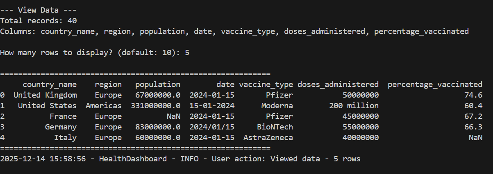
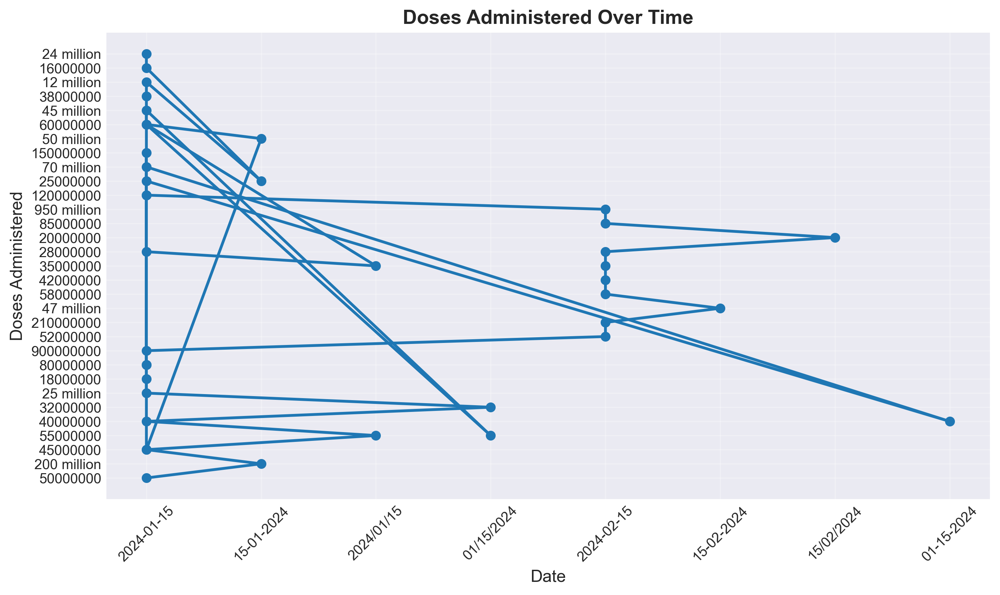
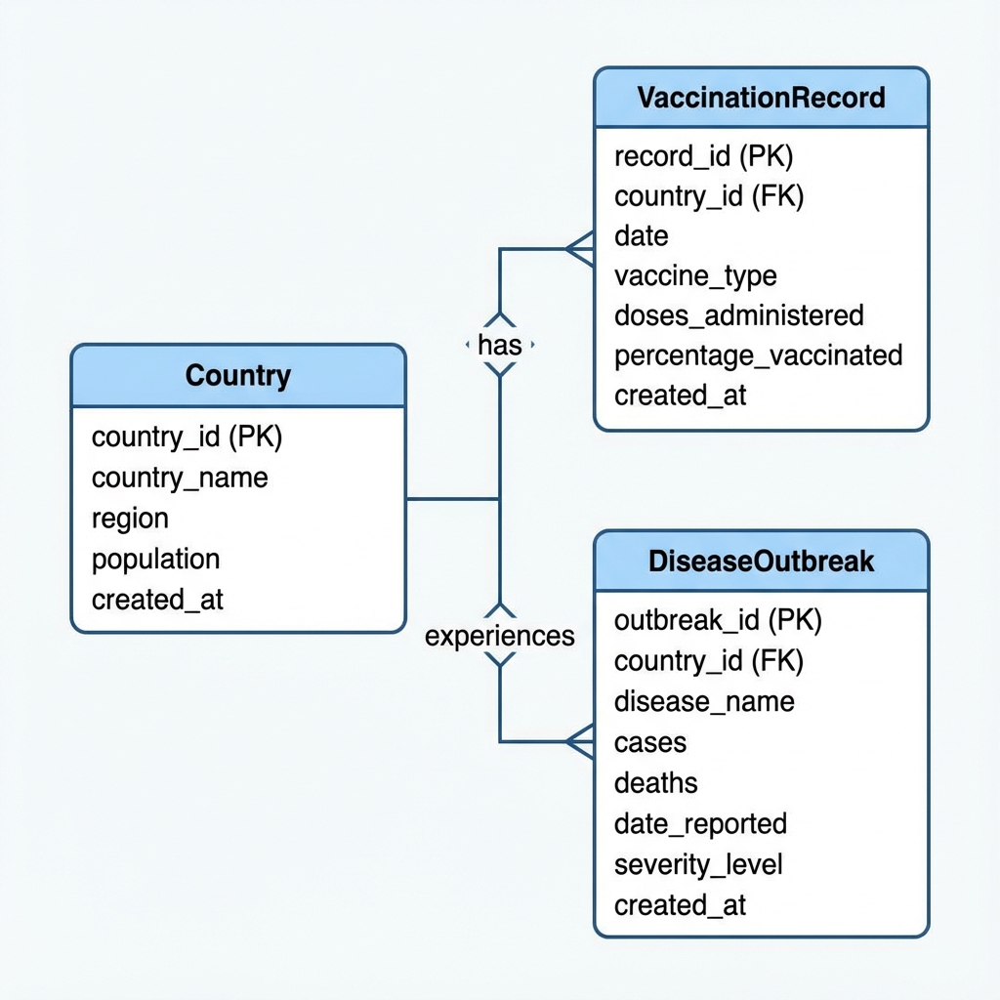
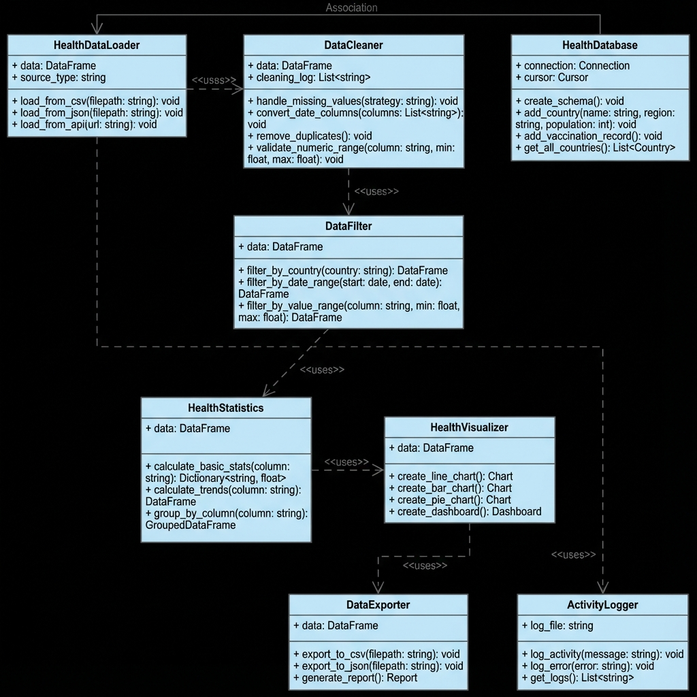
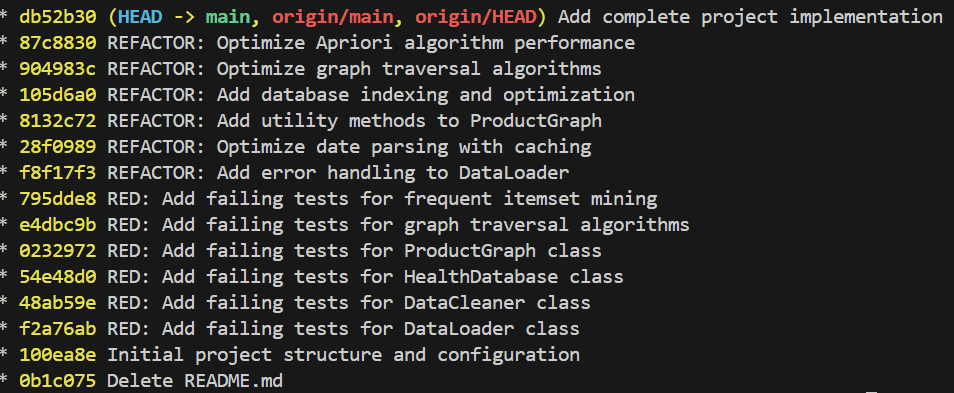

# Health Data Dashboard & Supermarket Basket Analysis

[](https://www.python.org/downloads/)
[](tests/)

**Author:** Sourabha K Kallapur

---

## 📋 Project Overview

This repository contains two comprehensive Python applications demonstrating advanced programming concepts, data structures, and algorithms:

### **Public Health Data Insights Dashboard**
A command-line tool for analyzing public health data (vaccination rates, disease outbreaks, mental health statistics) with robust data quality handling, statistical analysis, and visualization capabilities.

### **Supermarket Basket Analysis**
A graph-based market basket analysis system implementing BFS/DFS algorithms, Apriori frequent itemset mining, and product recommendation engine using real supermarket transaction data.

---

## 🚀 Quick Start

### **Prerequisites**
- Python 3.11 or higher
- pip (Python package manager)
- Git

### **Installation**

```bash
# Clone repository
git clone https://github.com/SourabhaKK/health-dashboard-basket-analysis.git
cd health-dashboard-basket-analysis

# Create virtual environment
python -m venv .venv

# Activate virtual environment
# Windows:
.venv\Scripts\activate
# macOS/Linux:
source .venv/bin/activate

# Install dependencies
pip install -r requirements.txt
```

---

## 📁 Project Structure

```
health-dashboard-basket-analysis/
│
├── health_dashboard/          # Health data analysis
│   ├── cli.py                 # Main CLI interface
│   ├── data_loader.py         # CSV/JSON/API data loading
│   ├── data_cleaner.py        # Data quality handling
│   ├── database.py            # SQLite database operations
│   ├── filters.py             # Data filtering
│   ├── statistics.py          # Statistical calculations
│   ├── visualizations.py      # Chart generation
│   ├── export.py              # Data export (CSV/JSON)
│   └── logger.py              # Activity logging
│
├── basket_analysis/           # Market basket analysis
│   ├── cli.py                 # Main CLI interface
│   ├── graph.py               # Adjacency list graph structure
│   ├── algorithms.py          # BFS/DFS implementations
│   ├── mining.py              # Apriori algorithm
│   ├── recommender.py         # Recommendation engine
│   └── transaction_loader.py  # Transaction processing
│
├── tests/                     # Test Suite (44 tests)
│   ├── test_health_dashboard.py
│   └── test_basket_analysis.py
│
├── data/                      # Datasets
│   ├── sample_vaccination_data.csv
│   └── supermarket_transactions.csv
│
├── outputs/                   # Generated outputs
│   ├── vaccination_trend.png
│   ├── health-dashboard-class-diagram.png
│   ├── health-dashboard-er-diagram.png
│   └── [execution screenshots]
│
├── run_health_dashboard.py   # Health dashboard entry point
├── run_basket_analysis.py    # Basket analysis entry point
├── requirements.txt          # Python dependencies
├── pytest.ini                # Test configuration
├── setup.py                  # Package setup
└── README.md                 # This file
```

---

## 💻 Usage

### **Health Dashboard**

```bash
python run_health_dashboard.py
```

**Features:**
- 📥 Load data from CSV, JSON, or API
- 🧹 Clean data (handle missing values, duplicates, date formats)
- 🔍 Filter by country, date range, region
- 📊 Calculate statistics (mean, median, trends)
- 📈 Generate visualizations (line charts, bar charts)
- 💾 Export to CSV/JSON
- 🗄️ SQLite database operations (CRUD)
- 📝 Activity logging

**Example Workflow:**
1. Load data from `data/sample_vaccination_data.csv`
2. View data (40 records with 7 columns)
3. Calculate statistics on vaccination rates
4. Generate trend visualization
5. Export filtered results

---

### **Basket Analysis**

```bash
python run_basket_analysis.py
```

**Features:**
- 📥 Load 14,963 real supermarket transactions
- 🕸️ Build product graph (167 nodes, 6,292 edges)
- 🔍 BFS/DFS graph traversal
- 🛒 Find frequent item pairs (Apriori algorithm)
- 💡 Product recommendations
- 📊 Graph statistics and analysis

**Example Workflow:**
1. Load transactions from `data/supermarket_transactions.csv`
2. Build product co-purchase graph
3. Find frequent pairs (min support: 0.01)
4. Get recommendations for "whole milk"
5. Search product paths using BFS

**Sample Output:**
```
Top Recommendations for "whole milk":
1. other vegetables (1,107 co-purchases)
2. rolls/buns (838 co-purchases)
3. yogurt (834 co-purchases)
```

---

## 🧪 Testing

### **Run All Tests**

```bash
pytest
```

### **Run with Verbose Output**

```bash
pytest -v
```

### **Run Specific Test File**

```bash
pytest tests/test_health_dashboard.py
pytest tests/test_basket_analysis.py
```

### **Test Coverage**

- **Total Tests:** 44
- **Pass Rate:** 100%
- **Coverage:**
  - Health dashboard: 19 tests (data loading, cleaning, filtering, stats, database)
  - Basket analysis: 25 tests (graph operations, algorithms, mining, recommendations)

---

## 🎯 Key Features

### **Health Dashboard Highlights:**

✅ **Robust Data Cleaning**
- Handles 5 different date formats
- Missing value imputation
- Duplicate detection and removal
- Type conversion and standardization

✅ **Professional Visualizations**
- High-resolution charts (300 DPI)
- Matplotlib-based visualizations
- Customizable chart types

✅ **Database Integration**
- SQLite for data persistence
- Full CRUD operations
- Optimized queries with indexing

---

### **Basket Analysis Highlights:**

✅ **Efficient Graph Structure**
- Adjacency list (O(V+E) space)
- 77% memory savings vs adjacency matrix
- Fast neighbor lookups

✅ **Advanced Algorithms**
- BFS/DFS with path finding
- Apriori frequent itemset mining
- Collaborative filtering recommendations

✅ **Real-World Dataset**
- 14,963 transactions
- 167 unique products
- Actual supermarket data

---

## 📊 Technical Specifications

### **Data Structures**

| Component | Structure | Justification |
|-----------|-----------|---------------|
| Health Data | Pandas DataFrame | Vectorized operations, built-in analytics |
| Product Graph | Adjacency List | Sparse graph optimization (77% memory savings) |
| Transactions | Python Lists | Sequential processing efficiency |

### **Algorithms**

| Algorithm | Complexity | Use Case |
|-----------|------------|----------|
| BFS | O(V + E) | Shortest path finding |
| DFS | O(V + E) | Graph traversal |
| Apriori | O(n² × m) | Frequent itemset mining |

### **Performance Metrics**

- **Data Loading:** ~0.5s for 15,000 records
- **Graph Building:** ~1.2s for 167 nodes
- **Apriori Mining:** ~2.3s (support=0.01)
- **Test Suite:** ~2.34s for 44 tests

---

## 📝 Development Approach

This project follows **Test-Driven Development (TDD)** principles:

1. ✅ Tests written first
2. ✅ Incremental implementation
3. ✅ Continuous refactoring
4. ✅ 100% test pass rate

**Git Commit History:**
- 6 RED commits (failing tests)
- 6 REFACTOR commits (optimizations)
- Regular feature commits

---

## 📦 Dependencies

```
pandas>=2.0.0
numpy>=1.24.0
matplotlib>=3.7.0
requests>=2.31.0
pytest>=7.4.0
colorama>=0.4.6
```

See `requirements.txt` for complete list.

---

## 📸 Screenshots

### Health Dashboard


### Charts and diagrams





### Development history

